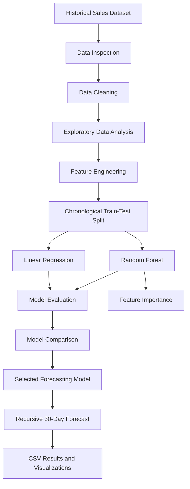

# Demand Forecasting Using Machine Learning

### A Time-Series Sales Forecasting Project Using Linear Regression and Random Forest


---

## Table of Contents

1. [Project Overview](#1-project-overview)
2. [Problem Statement](#2-problem-statement)
3. [Project Objectives](#3-project-objectives)
4. [Business Importance](#4-business-importance)
5. [Dataset Description](#5-dataset-description)
6. [Data Quality Assessment](#6-data-quality-assessment)
7. [Project Workflow](#7-project-workflow)
8. [Data Preprocessing](#8-data-preprocessing)
9. [Exploratory Data Analysis](#9-exploratory-data-analysis)
10. [Feature Engineering](#10-feature-engineering)
11. [Training and Testing Strategy](#11-training-and-testing-strategy)
12. [Machine Learning Models](#12-machine-learning-models)
13. [Model Evaluation Metrics](#13-model-evaluation-metrics)
14. [Model Performance Comparison](#14-model-performance-comparison)
15. [Feature Importance Analysis](#15-feature-importance-analysis)
16. [Future Sales Forecasting](#16-future-sales-forecasting)
17. [Project Results](#17-project-results)
18. [Project Directory Structure](#18-project-directory-structure)
19. [Technologies and Libraries](#19-technologies-and-libraries)
20. [Installation and Setup](#20-installation-and-setup)
21. [How to Run the Project](#21-how-to-run-the-project)
22. [Output Files](#22-output-files)
23. [Limitations](#23-limitations)
24. [Future Improvements](#24-future-improvements)
25. [Reproducibility](#25-reproducibility)
26. [Conclusion](#26-conclusion)
27. [Author](#27-author)

---

## 1. Project Overview

Demand forecasting is an important analytical process used to estimate future product demand or sales based on historical observations. Accurate forecasts can help businesses make better decisions regarding inventory management, production planning, purchasing, workforce allocation, and resource utilization.

This project develops a machine learning-based sales forecasting pipeline using historical daily sales data. The workflow covers data inspection, cleaning, exploratory data analysis, feature engineering, model development, performance evaluation, model comparison, and recursive forecasting for a future 30-day period.

Two supervised machine learning algorithms are implemented and evaluated:

- Linear Regression
- Random Forest Regressor

Both models are evaluated on the same chronological test period using Mean Absolute Error (MAE), Root Mean Squared Error (RMSE), and the coefficient of determination (R²).

Based on the experimental results obtained from the current dataset, Linear Regression performs slightly better than Random Forest across all three evaluation metrics.

The project also uses the selected Linear Regression model to generate a 30-day recursive sales forecast.

### Key Project Highlights

- Daily historical sales analysis
- Data cleaning and preprocessing
- Time-based feature engineering
- Lag-based and rolling-window features
- Chronological training and testing
- Comparison of two machine learning algorithms
- Quantitative model evaluation
- Feature importance analysis for Random Forest
- Recursive 30-day sales forecasting
- Automated generation of CSV outputs and visualization files

---

## 2. Problem Statement

Businesses often need to estimate future demand before making operational decisions. However, future demand is uncertain and may be influenced by historical sales behavior, weekly patterns, seasonal variation, and other factors.

Without a systematic forecasting approach, businesses may experience:

- Excess inventory and increased holding costs
- Stockouts and missed sales opportunities
- Inefficient production schedules
- Poor allocation of labor and resources
- Difficulty planning procurement activities

The objective of this project is to investigate whether historical daily sales observations and engineered time-series features can be used to predict future sales.

The project formulates sales forecasting as a supervised regression problem. Historical sales and derived features are used as input variables, while the corresponding sales value is the target variable.

The developed models are compared using a consistent chronological test set to identify which approach provides better predictive performance on the available data.

---

## 3. Project Objectives

The primary objectives of this project are:

1. Inspect and understand the structure of the historical sales dataset.
2. Identify missing values, duplicate observations, invalid dates, and data quality issues.
3. Prepare a clean, chronologically ordered dataset for analysis.
4. Explore daily sales behavior through statistical summaries and visualizations.
5. Engineer calendar, lag, cyclical, and rolling-statistics features.
6. Split the data chronologically to preserve the time-series structure.
7. Train Linear Regression and Random Forest regression models.
8. Evaluate model performance using MAE, RMSE, and R².
9. Compare both models on the same test observations.
10. Analyze Random Forest feature importance.
11. Generate a recursive 30-day sales forecast.
12. Save trained models, predictions, evaluation results, and visualizations for further analysis.

---

## 4. Business Importance

Demand forecasting connects historical data analysis with practical business planning.

Potential applications include:

### Inventory Management

Forecasted demand can support replenishment planning and help reduce the risk of overstocking or stockouts.

### Production Planning

Manufacturers can use expected demand to plan production quantities, machine utilization, and material requirements.

### Procurement Planning

Forecasts can provide an initial estimate of future material requirements and support purchasing decisions.

### Workforce Planning

Expected changes in demand can help managers plan staffing levels and work schedules.

### Sales and Operations Planning

Forecasting can provide quantitative input for budgeting, capacity planning, and operational decision-making.

**Important:** The current project demonstrates forecasting methodology. Its predictions should not be treated as production-ready business recommendations without additional validation, operational data, and uncertainty analysis.

---

## 5. Dataset Description

The project uses a historical daily sales dataset stored in Excel format.

**Expected source file:** `data/dataset.xlsx`

### Dataset Summary

| Property | Value |
|---|---|
| Initial number of rows | 1,826 |
| Initial number of columns | 3 |
| Date coverage | 2013-01-01 to 2017-12-31 |
| Target variable | `sales` |
| Date variable | `date` |
| Removed identifier/index column | `Unnamed: 0` |
| Cleaned number of rows | 1,826 |
| Cleaned number of columns | 2 |

### Original Columns

| Column | Description | Treatment |
|---|---|---|
| `Unnamed: 0` | Unnamed index or identifier column | Removed |
| `date` | Date associated with the sales observation | Converted to datetime |
| `sales` | Recorded sales value | Converted to numeric |

The `sales` column is the target variable the models attempt to predict.

The date column is used to derive temporal features such as month, day of the week, and day of the year.

### Target Variable

The target variable is:

`sales`

Observed descriptive statistics from the original dataset:

| Statistic | Value |
|---|---:|
| Count | 1,826 |
| Mean | 19.9715 |
| Standard deviation | 6.7410 |
| Minimum | 4 |
| Median | 19 |
| Maximum | 50 |

These statistics describe the observed dataset and do not represent forecasted sales.

**Data interpretation note:** The dataset's business context, product category, currency, and unit of sales have not been established in the current analysis. Therefore, sales values are reported in the dataset's original units.

---

## 6. Data Quality Assessment

Initial inspection was performed to understand the dataset's dimensions, column types, date range, missing values, duplicates, and numerical distribution.

### Initial Inspection Results

| Check | Result |
|---|---|
| Dataset shape | 1,826 rows × 3 columns |
| Missing values | 0 |
| Duplicate rows | 0 |
| Date range | 2013-01-01 to 2017-12-31 |
| Sales data type | Validated and converted to numeric |
| Date format | Parsed into datetime |

The initial inspection did not identify missing values or duplicate rows. Nevertheless, explicit cleaning and validation were retained in the preprocessing workflow.

After preprocessing, the cleaned dataset contained 1,826 rows and two columns, with no missing values and no duplicate dates.

---

## 7. Project Workflow

The project follows a structured machine learning workflow.

1. **Data inspection:** Understand the dataset's dimensions, columns, types, and statistical properties.
2. **Data cleaning:** Standardize column names, parse dates, validate sales values, and remove invalid observations.
3. **Exploratory data analysis:** Visualize sales trends, distributions, and temporal patterns.
4. **Feature engineering:** Create calendar variables, cyclical encodings, lag features, and rolling statistics.
5. **Chronological splitting:** Use earlier observations for training and later observations for testing.
6. **Model development:** Train Linear Regression and Random Forest regressors.
7. **Model evaluation:** Calculate MAE, RMSE, and R² on the common test period.
8. **Model comparison:** Compare predictions and evaluation metrics.
9. **Feature interpretation:** Examine Random Forest feature importance.
10. **Future forecasting:** Generate recursive predictions for the next 30 days after the historical dataset ends.
11. **Output generation:** Save models, forecasts, evaluation tables, and figures.

### Workflow Diagram



---

## 8. Data Preprocessing

Data preprocessing prepares the raw dataset for reliable analysis and model development.

The cleaning process includes the following operations.

### 8.1 Remove Unnecessary Columns

The `Unnamed: 0` column was removed because it was an unnecessary index-like column for the forecasting task.

### 8.2 Convert Dates

The `date` column was converted to datetime format to enable sorting, time-based feature generation, and chronological splitting.

### 8.3 Validate Sales Values

The sales column was converted to numeric format. Invalid date or sales observations were removed when conversion resulted in missing values.

### 8.4 Sort Chronologically

Observations were sorted by date in ascending order so that earlier observations precede later observations.

### 8.5 Remove Duplicate Dates

Duplicate dates were removed to maintain a single daily observation per date.

### 8.6 Save the Cleaned Dataset

The cleaned dataset was saved as:

`data/cleaned_sales.csv`

The cleaned dataset contains:

- `date`
- `sales`

The resulting dataset contains 1,826 rows and two columns.

---

## 9. Exploratory Data Analysis

Exploratory Data Analysis (EDA) is used to understand the historical behavior of sales before developing forecasting models.

Three visualization outputs were generated.

### 9.1 Daily Sales Trend

**File:** `data/daily_sales_trend.png`

This figure displays sales observations over time.

It can help investigate:

- Changes in sales levels
- Short-term fluctuations
- Potential recurring patterns
- Unusually high or low observations
- Possible long-term movement in sales


### 9.2 Sales Pattern Analysis

**File:** `data/eda_sales_patterns.png`

This visualization contains additional sales-pattern analysis.

It supports the investigation of time-related behavior, including potential differences across calendar periods and days of the week.


### 9.3 Sales Distribution and Outliers

**File:** `data/sales_distribution_outliers.png`

This figure examines the distribution of sales values and highlights observations that may be unusual relative to the overall distribution.

Outlier identification does not automatically mean that an observation is incorrect. Genuine high-demand or low-demand periods can produce extreme values.


### Why EDA Matters

EDA helps identify patterns that may influence feature engineering and model selection.

However, visual patterns alone do not establish causality. Additional business information would be required to determine why specific sales changes occurred.

---

## 10. Feature Engineering

Feature engineering transforms raw dates and historical sales observations into variables that machine learning algorithms can use.

The feature engineering process generates 15 predictor variables.

### 10.1 Calendar Features

| Feature | Description |
|---|---|
| `year` | Calendar year |
| `month` | Calendar month, from 1 to 12 |
| `day` | Day of the month |
| `day_of_week` | Day of the week |
| `day_of_year` | Position within the calendar year |
| `is_weekend` | Indicator for weekend observations |

These variables provide information about the calendar context of each sales observation.

### 10.2 Cyclical Features

Calendar variables such as month and weekday are cyclical. For example, December is close to January in the annual cycle, while Sunday and Monday are adjacent in the weekly cycle.

To represent this structure, the project creates sine and cosine transformations.

The general transformation is:

\[
\text{sin feature} =
\sin\left(\frac{2\pi x}{P}\right)
\]

\[
\text{cos feature} =
\cos\left(\frac{2\pi x}{P}\right)
\]

Here, \(x\) is the calendar position and \(P\) is the length of the cycle.

The engineered cyclical features are:

- `month_sin`
- `month_cos`
- `weekday_sin`
- `weekday_cos`

These transformations represent calendar positions on a circular scale.

### 10.3 Lag Features

Lag features represent previously observed sales values.

| Feature | Description |
|---|---|
| `sales_lag_1` | Sales from the previous day |
| `sales_lag_7` | Sales from seven days earlier |
| `sales_lag_14` | Sales from fourteen days earlier |

Lag features help the models use recent historical behavior as predictive information.

For example, the previous day's sales may provide useful information about the current day's sales. A seven-day lag can also help represent weekly repetition.

### 10.4 Rolling Mean Features

Rolling means summarize recent sales behavior.

| Feature | Description |
|---|---|
| `sales_rolling_mean_7` | Mean sales over the previous seven observations |
| `sales_rolling_mean_30` | Mean sales over the previous thirty observations |

The rolling features are shifted by one observation before calculating their rolling means.

Conceptually:

\[
\text{RollingMean}_{7,t}
=
\frac{1}{7}
\sum_{i=1}^{7} y_{t-i}
\]

\[
\text{RollingMean}_{30,t}
=
\frac{1}{30}
\sum_{i=1}^{30} y_{t-i}
\]

Here, \(y_t\) represents sales at time \(t\).

The shift ensures that the rolling means use past observations rather than the current target value.

### 10.5 Avoiding Target Leakage

A forecasting model must not receive information from the target observation that it is trying to predict.

For example, calculating a rolling average that includes the current day's actual sales would leak target information into the features.

The project shifts rolling calculations by one day to avoid this problem.

Lag features also use past sales observations.

### 10.6 Feature Engineering Results

| Property | Result |
|---|---:|
| Initial cleaned observations | 1,826 |
| Usable observations after lag and rolling calculations | 1,796 |
| Number of predictor features | 15 |
| Training observations | 1,436 |
| Testing observations | 360 |

The first 30 observations are unavailable for modeling because the 30-day rolling mean requires sufficient historical data.

The model-ready dataset was saved as:

`data/model_ready.csv`

The chronological subsets were saved as:

- `data/train.csv`
- `data/test.csv`

---

## 11. Training and Testing Strategy

Time-series data must be divided carefully because observations have a temporal order.

A random train-test split could place future observations in the training set and earlier observations in the testing set. This would make the evaluation less representative of forecasting future sales.

Therefore, the project uses a chronological 80/20 split.

### Split Summary

| Property | Training Set | Testing Set |
|---|---|---|
| Number of observations | 1,436 | 360 |
| First date | 2013-01-31 | 2017-01-06 |
| Last date | 2017-01-05 | 2017-12-31 |
| Purpose | Model fitting | Out-of-sample evaluation |

The training set contains earlier observations, while the testing set contains later observations.

Both models are evaluated on the same test period so that their metrics can be compared fairly.

### Evaluation Scope

The test metrics represent one-step-ahead predictions using features generated from the historical dataset, including actual past sales values where those observations are available.

This is different from recursive multi-day forecasting, where predicted sales values become inputs for subsequent forecast days.

The distinction is important when interpreting model performance.

---

## 12. Machine Learning Models

Two regression algorithms were implemented to compare a simple linear approach with a nonlinear ensemble method.

### 12.1 Linear Regression

Linear Regression estimates a target value as a weighted combination of input features.

The general model can be represented as:

\[
\hat{y} =
\beta_0 + \sum_{j=1}^{p}\beta_j x_j
\]

Where:

- \(\hat{y}\) is the predicted sales value.
- \(\beta_0\) is the intercept.
- \(\beta_j\) is the coefficient for feature \(j\).
- \(x_j\) is the corresponding input feature.
- \(p\) is the number of features.

The algorithm estimates coefficients that minimize the sum of squared residuals on the training data.

#### Why Linear Regression?

- Provides a relatively simple baseline.
- Is computationally efficient.
- Offers a useful reference point for model comparison.
- Can capture linear relationships between engineered features and sales.

#### Saved Model

`models/linear_regression.joblib`

#### Prediction Output

`data/linear_regression_predictions.csv`

### 12.2 Random Forest Regressor

Random Forest is an ensemble learning algorithm that combines predictions from multiple decision trees.

Instead of relying on a single tree, the model aggregates predictions from many trees. This allows it to capture nonlinear relationships and interactions between input features.

The project uses the following configuration:

| Parameter | Value |
|---|---:|
| `n_estimators` | 200 |
| `max_depth` | 12 |
| `min_samples_leaf` | 3 |
| `random_state` | 42 |
| `n_jobs` | -1 |

#### Why Random Forest?

- Can represent nonlinear relationships.
- Can model interactions between features.
- Does not require linear relationships between all inputs and the target.
- Provides feature importance scores for interpretation.

#### Saved Model

`models/random_forest.joblib`

#### Prediction Output

`data/random_forest_predictions.csv`

#### Feature Importance Output

`data/random_forest_feature_importance.csv`

### 12.3 Model Selection Principle

The two algorithms are compared using the same test observations and the same evaluation metrics.

The model with the lowest error is generally preferred when the goal is to minimize forecast error, subject to the limitations of the evaluation setup.

For this experiment, Linear Regression achieved slightly better results than Random Forest.

This result does not imply that Linear Regression will outperform Random Forest on every dataset or forecasting horizon.

---

## 13. Model Evaluation Metrics

Three metrics are used to evaluate model performance.

### 13.1 Mean Absolute Error (MAE)

MAE measures the average absolute difference between actual and predicted sales.

\[
MAE =
\frac{1}{n}
\sum_{i=1}^{n}
|y_i-\hat{y}_i|
\]

Where:

- \(y_i\) is the actual value.
- \(\hat{y}_i\) is the predicted value.
- \(n\) is the number of test observations.

**Interpretation:** Lower MAE indicates a smaller average absolute prediction error.

MAE is expressed in the same units as the target variable.

### 13.2 Root Mean Squared Error (RMSE)

RMSE is the square root of the average squared prediction error.

\[
RMSE =
\sqrt{
\frac{1}{n}
\sum_{i=1}^{n}
(y_i-\hat{y}_i)^2
}
\]

RMSE penalizes larger errors more heavily than MAE because errors are squared before averaging.

**Interpretation:** Lower RMSE indicates better performance under this error measure.

### 13.3 Coefficient of Determination (R²)

R² compares the model's prediction errors with the variation in the observed target values.

\[
R^2 =
1 -
\frac{\sum_{i=1}^{n}(y_i-\hat{y}_i)^2}
{\sum_{i=1}^{n}(y_i-\bar{y})^2}
\]

Where \(\bar{y}\) is the mean of the actual target values in the evaluation set.

General interpretation:

- \(R^2 = 1\): Perfect predictions on the evaluated observations.
- \(R^2 = 0\): Performance equivalent to predicting the test-set mean under the standard definition.
- \(R^2 < 0\): Performance worse than that mean-based reference under the metric's definition.

R² is not a percentage accuracy score.

---

## 14. Model Performance Comparison

Both models were evaluated on the same 360 test observations.

### Experimental Results

| Metric | Linear Regression | Random Forest | Better Result |
|---|---:|---:|---|
| MAE | 4.0031 | 4.1296 | Linear Regression |
| RMSE | 4.9088 | 5.0841 | Linear Regression |
| R² | 0.4980 | 0.4615 | Linear Regression |

### Interpretation

#### Mean Absolute Error

Linear Regression achieved an MAE of 4.0031, compared with 4.1296 for Random Forest.

The Linear Regression model therefore produced a smaller average absolute error on the test set.

#### Root Mean Squared Error

Linear Regression achieved an RMSE of 4.9088, compared with 5.0841 for Random Forest.

This indicates that Linear Regression also performed better under the squared-error-based metric.

#### R² Score

Linear Regression achieved an R² of 0.4980, while Random Forest achieved 0.4615.

The Linear Regression model explained a larger proportion of the observed variation relative to the test-set mean baseline, according to this metric.

An R² of 0.4980 does not mean that the model has 49.8% prediction accuracy.

### Model Comparison Visualization

**File:** `data/model_comparison.png`


### Selected Model

**Linear Regression is the preferred model among the two models evaluated in this experiment.**

This choice is based on its lower MAE, lower RMSE, and higher R² on the common test period.

The selection is limited to the algorithms, features, parameters, and evaluation method tested in this project. More advanced baselines and forecasting methods may achieve better results.

---

## 15. Feature Importance Analysis

Random Forest feature importance was examined to understand which input variables contributed most to the model's tree-based predictive decisions.

### Top Features

| Rank | Feature | Importance |
|---:|---|---:|
| 1 | `sales_rolling_mean_7` | 0.2592 |
| 2 | `sales_rolling_mean_30` | 0.2326 |
| 3 | `day_of_week` | 0.0905 |
| 4 | `weekday_sin` | 0.0746 |
| 5 | `sales_lag_7` | 0.0606 |
| 6 | `day` | 0.0519 |
| 7 | `day_of_year` | 0.0518 |
| 8 | `sales_lag_14` | 0.0482 |
| 9 | `sales_lag_1` | 0.0438 |
| 10 | `month_cos` | 0.0260 |

### Interpretation

The seven-day rolling mean has the highest reported importance, followed by the 30-day rolling mean.

This suggests that recent average sales levels were particularly useful to the fitted Random Forest model.

Calendar-related features and lagged sales values also contributed to the model's predictions.

### Feature Importance Visualization

**File:** `data/feature_importance.png`


### Important Note

Random Forest feature importance describes the model's use of features, not causal relationships.

Correlated variables may share or redistribute importance. A high importance score does not establish that a feature independently causes changes in sales.

---

## 16. Future Sales Forecasting

After model comparison, the Linear Regression model was used to produce a recursive forecast for the next 30 days following the historical dataset.

### Forecast Period

| Property | Value |
|---|---|
| Last historical date | 2017-12-31 |
| Forecast start date | 2018-01-01 |
| Forecast end date | 2018-01-30 |
| Forecast horizon | 30 days |
| Forecasting approach | Recursive |
| Model used | Linear Regression |

These dates are based on the end of the supplied historical dataset. They are not current-date forecasts.

### Forecast Summary

| Statistic | Predicted Sales |
|---|---:|
| Mean | 19.01 |
| Minimum | 14.92 |
| Maximum | 23.74 |

The values above summarize the generated 30-day forecast. They are model predictions rather than actual observed sales.

### What Is Recursive Forecasting?

In recursive forecasting, the model predicts the next time step first. The predicted value is then used to update lag and rolling features for the following step.

The process repeats until the required forecast horizon is reached.

Conceptually:

1. Use the final historical observations to construct features.
2. Predict sales for the next day.
3. Append the predicted value to the available sales history.
4. Recalculate the lag and rolling features for the next day.
5. Repeat until all 30 forecast values have been generated.

### Forecast Visualization

**File:** `data/future_30_days_forecast.png`


### Forecast Output

The forecast is saved as:

`data/future_30_days_forecast.csv`

The output includes the forecast dates and their corresponding predicted sales values.

### Forecasting Limitations

Recursive forecasts may accumulate prediction errors because earlier predictions are reused to generate later predictions.

Consequently, the 30-day forecast should not be interpreted as having the same error characteristics as the one-step-ahead test evaluation.

No prediction intervals or confidence intervals are currently produced.

---

## 17. Project Results

The completed workflow produces the following outcomes:

- Inspected and cleaned 1,826 daily sales observations.
- Preserved the historical date order during preprocessing.
- Generated 15 predictor features.
- Prepared 1,436 training observations and 360 test observations.
- Trained Linear Regression and Random Forest models.
- Evaluated both models using MAE, RMSE, and R².
- Identified Linear Regression as the better-performing model among the two tested algorithms.
- Generated Random Forest feature importance results.
- Produced a recursive 30-day forecast.
- Saved intermediate datasets, model files, prediction files, comparison tables, and plots.

### Main Findings

1. Linear Regression outperformed Random Forest on the selected test period.
2. Rolling sales averages were the most important features in the Random Forest model.
3. Historical sales and calendar-derived features provided the basis for the forecasting pipeline.
4. Recursive forecasting extended the model beyond the historical observations, but forecast uncertainty was not quantified.

These findings apply to the current dataset and experimental configuration. Additional validation would be required before using the model in an operational forecasting system.

---

## 18. Project Directory Structure

The project is organized into data, source code, and model artifacts.

```text
Demand forecasting_ML/
│
├── data/
│   ├── dataset.xlsx
│   ├── cleaned_sales.csv
│   ├── model_ready.csv
│   ├── train.csv
│   ├── test.csv
│   ├── daily_sales_trend.png
│   ├── eda_sales_patterns.png
│   ├── sales_distribution_outliers.png
│   ├── linear_regression_predictions.csv
│   ├── random_forest_predictions.csv
│   ├── random_forest_feature_importance.csv
│   ├── model_comparison.csv
│   ├── model_comparison.png
│   ├── feature_importance.png
│   ├── future_30_days_forecast.csv
│   └── future_30_days_forecast.png
│
├── models/
│   ├── linear_regression.joblib
│   └── random_forest.joblib
│
├── src/
│   ├── feature_engineering.py
│   ├── linear_regression.py
│   ├── random_forest.py
│   ├── model_comparison.py
│   └── forecast_next_30_days.py
│
├── .gitignore
├── README.md
├── requirements.txt
└── requirements-lock.txt
```

The structure above documents the expected project artifacts. Some files, such as `requirements-lock.txt`, may be optional depending on the final repository setup.

The original dataset, generated files, and trained models should be included in the repository only when appropriate for their size, licensing, and intended distribution.

---

## 19. Technologies and Libraries

### Programming Language

**Python 3.12.4**

### Libraries

| Library | Purpose |
|---|---|
| pandas | Data manipulation, cleaning, and CSV processing |
| NumPy | Numerical operations |
| Matplotlib | Plot generation and visualization |
| scikit-learn | Machine learning models and evaluation metrics |
| openpyxl | Reading Excel files through pandas |
| joblib | Saving and loading trained model artifacts |

### Development Environment

The project was developed and executed in a Windows environment using PowerShell.

Python scripts are organized under the `src/` directory, while datasets and generated results are stored under `data/`.

---

## 20. Installation and Setup

Follow these steps to reproduce the project locally.

### Prerequisites

Install Python 3.12 or a compatible Python version and ensure that Python is available through the terminal.

Verify the installation:

```powershell
py --version
py -m pip --version
```

### Step 1: Clone the Repository

Replace the example URL with the actual URL of your GitHub repository.

```powershell
git clone <YOUR_GITHUB_REPOSITORY_URL>
cd "Demand forecasting_ML"
```

If the repository has a different folder name, enter the folder created by the clone command.

### Step 2: Create a Virtual Environment

```powershell
py -m venv .venv
```

### Step 3: Activate the Environment

```powershell
.\.venv\Scripts\Activate.ps1
```

If PowerShell blocks script execution, use an approved environment-specific execution policy or activate the environment through another terminal. Avoid changing system-wide security settings unnecessarily.

### Step 4: Install Dependencies

```powershell
py -m pip install -r requirements.txt
```

If you are using the virtual environment, the command above will use its Python installation when the environment is activated.

### Step 5: Prepare the Dataset

Place the original Excel dataset at:

```text
data/dataset.xlsx
```

The original dataset is required to reproduce the full workflow from raw data.

---

## 21. How to Run the Project

Run commands from the project root directory.

### Step 1: Inspect and Clean the Dataset

Run the cleaning script used to generate:

```text
data/cleaned_sales.csv
```

Use the existing preprocessing script from your project if it is included in the repository.

### Step 2: Perform Exploratory Data Analysis

Run the existing EDA script, if included, to regenerate the EDA visualizations.

Expected outputs include:

```text
data/daily_sales_trend.png
data/eda_sales_patterns.png
data/sales_distribution_outliers.png
```

### Step 3: Generate Features

```powershell
py src/feature_engineering.py
```

This generates the model-ready dataset and the chronological train-test files.

### Step 4: Train Linear Regression

```powershell
py src/linear_regression.py
```

This trains the Linear Regression model and saves the model and test predictions.

### Step 5: Train Random Forest

```powershell
py src/random_forest.py
```

This trains the Random Forest model and generates predictions and feature importance values.

### Step 6: Compare Model Performance

```powershell
py src/model_comparison.py
```

This produces the model comparison table and visualization.

### Step 7: Generate the 30-Day Forecast

```powershell
py src/forecast_next_30_days.py
```

This generates the recursive forecast for the next 30 days after the last historical date.

**Execution note:** The repository should include the actual preprocessing and EDA scripts if you want every stage to be reproducible from the raw Excel file. The current documented source-code inventory includes the feature engineering, model training, comparison, and forecasting scripts.

---

## 22. Output Files

The project produces several types of output.

### Processed Datasets

| File | Purpose |
|---|---|
| `cleaned_sales.csv` | Cleaned date and sales observations |
| `model_ready.csv` | Dataset with engineered predictor features |
| `train.csv` | Chronological training data |
| `test.csv` | Chronological testing data |

### Model Artifacts

| File | Purpose |
|---|---|
| `linear_regression.joblib` | Saved Linear Regression model |
| `random_forest.joblib` | Saved Random Forest model |

### Prediction and Evaluation Results

| File | Purpose |
|---|---|
| `linear_regression_predictions.csv` | Linear Regression test predictions |
| `random_forest_predictions.csv` | Random Forest test predictions |
| `model_comparison.csv` | Comparative evaluation results |
| `random_forest_feature_importance.csv` | Feature importance values |
| `future_30_days_forecast.csv` | Forecasted values for 30 future time steps |

### Visualization Files

| File | Purpose |
|---|---|
| `daily_sales_trend.png` | Historical daily sales trend |
| `eda_sales_patterns.png` | EDA pattern analysis |
| `sales_distribution_outliers.png` | Sales distribution and potential outliers |
| `model_comparison.png` | Model performance comparison |
| `feature_importance.png` | Random Forest feature importance |
| `future_30_days_forecast.png` | Recursive 30-day forecast visualization |

---

## 23. Limitations

Although the project demonstrates an end-to-end forecasting workflow, several limitations should be considered.

### 23.1 Limited Dataset Context

The current analysis does not establish the business identity, product category, sales units, or operational context behind the dataset.

### 23.2 Limited Model Selection

Only Linear Regression and Random Forest have been compared. Other time-series and machine learning methods may perform better.

### 23.3 Limited Hyperparameter Optimization

The current Random Forest configuration uses specified hyperparameters. A systematic time-series-aware tuning process has not been established as part of the reported experiment.

### 23.4 No External Predictors

The current feature set does not include external variables such as:

- Price and discount information
- Marketing campaigns
- Holidays and special events
- Weather conditions
- Product availability
- Economic indicators

Such information may improve forecasting if it is relevant, reliable, and available at the time forecasts are generated.

### 23.5 Recursive Forecast Error

Errors can accumulate when predicted sales values are used to generate later forecast features.

### 23.6 No Forecast Intervals

The current implementation provides point forecasts only. It does not quantify uncertainty using prediction intervals or probabilistic forecasting.

### 23.7 Evaluation Scope

The reported metrics are based on one chronological holdout period. Additional rolling-origin backtesting would provide a more comprehensive assessment of performance across different periods.

### 23.8 No Operational Deployment

The current project is an offline analytical pipeline. It does not include a deployed API, automated data ingestion, monitoring, or a production dashboard.

---

## 24. Future Improvements

Several improvements could extend the project.

### Model Development

- Add a seasonal naive baseline.
- Evaluate moving-average forecasting methods.
- Investigate dedicated time-series models such as ARIMA or SARIMA.
- Evaluate gradient boosting algorithms where appropriate.
- Tune model hyperparameters using time-series cross-validation.

### Evaluation

- Implement rolling-origin or expanding-window backtesting.
- Compare performance across multiple forecast horizons.
- Report error metrics by month, weekday, or demand level.
- Evaluate forecast bias and stability.
- Compare recursive forecasting with direct multi-step forecasting.

### Feature Engineering

- Add holiday and special-event indicators.
- Incorporate promotions, prices, and product-level information when available.
- Investigate additional seasonal features.
- Evaluate lag windows appropriate to the data's demand patterns.

### Forecast Uncertainty

- Generate prediction intervals.
- Evaluate interval coverage and width.
- Communicate uncertainty to decision-makers.

### Deployment and Monitoring

- Build an interactive forecasting dashboard using Streamlit.
- Provide configurable forecast horizons.
- Add automated data validation.
- Monitor model performance as new actual sales data becomes available.
- Establish a retraining schedule when justified by new data and evaluation results.

These are potential extensions, not capabilities already implemented in the current version.

---

## 25. Reproducibility

The project saves intermediate datasets, trained models, predictions, and visualization outputs so that the workflow can be inspected and evaluated.

For more reproducible experiments, the following practices are recommended:

- Keep the original dataset unchanged.
- Record Python and library versions.
- Use consistent model parameters and random seeds.
- Preserve the chronological train-test split.
- Document any changes to features or preprocessing.
- Re-run model evaluation after changing the dataset or model configuration.
- Keep generated results associated with the code version that produced them.

The Random Forest uses `random_state=42` to make its randomized training process more reproducible under the same environment and data.

The repository includes a `requirements.txt` file for installing the primary dependencies. A lock file can additionally record exact installed package versions.

---

## 26. Conclusion

This project demonstrates a structured approach to daily sales forecasting using machine learning.

The workflow includes data inspection, preprocessing, exploratory data analysis, feature engineering, chronological splitting, model training, quantitative evaluation, feature importance analysis, and recursive forecasting.

Linear Regression achieved an MAE of 4.0031, an RMSE of 4.9088, and an R² of 0.4980 on the selected test period. It performed slightly better than the Random Forest model under all three reported metrics.

The Random Forest feature importance analysis identified seven-day and thirty-day rolling sales averages as the most influential features within that fitted model.

Finally, the selected Linear Regression model generated a 30-day recursive forecast for January 2018, based on the dataset ending on December 31, 2017.

The project provides a foundation for further work in time-series validation, forecasting uncertainty, feature enrichment, model optimization, and deployment.

The results should be interpreted as an experimental evaluation on the available dataset rather than a guarantee of future operational performance.

---

## 27. Author

**Project:** Demand Forecasting Using Machine Learning

**Focus Areas:**
- Data preprocessing
- Exploratory data analysis
- Feature engineering
- Supervised machine learning
- Time-series forecasting
- Model evaluation and comparison

Developed as a machine learning project to demonstrate a complete workflow from historical sales data to model evaluation and future demand prediction.

---

## License and Dataset Attribution

No license or original dataset attribution has been specified in this README.

Before publicly redistributing the dataset or repository, verify the dataset's original source, permitted usage, and redistribution conditions. Add an appropriate license and dataset citation when these details are confirmed.
